# 空中飞人 · 上头观察室

一款自娱自乐的**黑色喜剧外汇模拟游戏**。你扮演一个不肯离场的赌狗，在模拟行情、真实历史汇率和 14 份金融危机档案里反复上头。

这里不生产财富，只记录你是怎么上头的。

## 启动

双击 `start.cmd`，或在项目目录执行：

```bash
node server.js
```

打开 <http://127.0.0.1:8130/>。

> 不要直接双击 `index.html`：`file://` 会限制浏览器存档和历史汇率请求。用本地服务器才完整。

## 桌面快捷方式

桌面上已经放了一个 **空中飞人** 快捷方式，双击会运行 `AirTrapeze.exe`（一个带图标的小启动器，转调 `start.cmd`）：

- 如果 8130 端口已经在跑，只打开浏览器；
- 如果没跑，启动本地服务器并打开 <http://127.0.0.1:8130/>。

图标文件：

- `assets/icon.svg`：矢量源文件
- `assets/icon.png`：256×256 PNG
- `assets/icon.ico`：Windows 多尺寸图标（16–256）
- `AirTrapeze.exe`：内嵌图标的启动器

如果移动了项目目录，快捷方式需要重建；图标本身不会丢。

## 新手流程

第一次进入：

1. 欢迎页点「先学怎么输」；
2. 4 步教程：方向、保证金/杠杆、60%/80% 风险、收手；
3. **免费练习一笔**：保证金 $100、杠杆 10×，不算合同；
4. 平仓后，练习成绩清空，回到 $10,000，再选合同或自由模式。

练习期间，下单面板会出现一条“第一次试水”提示，告诉你每一步做什么。进阶交易（止损/止盈）默认关闭，不会一上来就塞两个价格输入框。

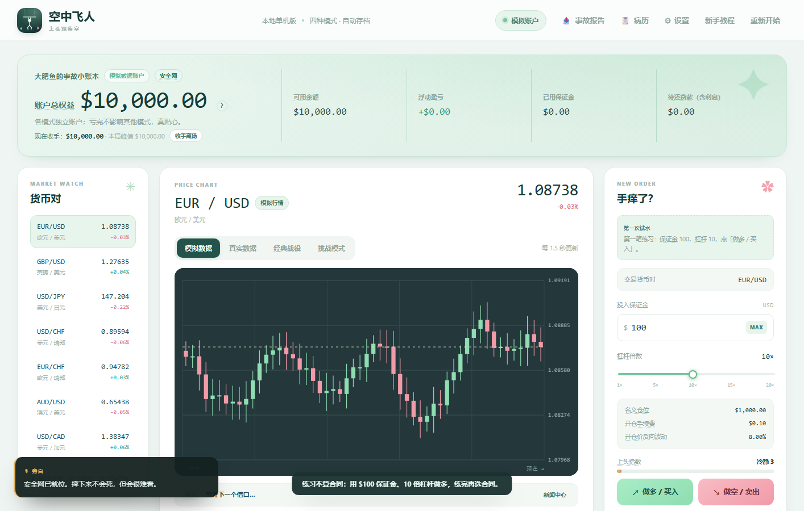

## 昵称

设置 →「我的名字」可以改昵称：

- 默认叫**大肥鱼**；
- 最多 12 个字，留空会恢复默认；
- 显示在账户卡左上角「XX 的事故小账本」，收手/穿仓结算里也会叫这个名字；
- 只保存在本机设置里，不上传。

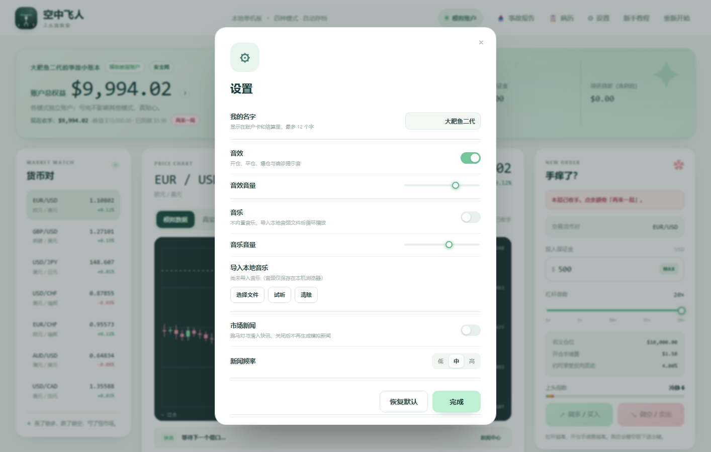

## 术语注释

界面上带**虚线下划线**的词都可以点：

- 保证金、杠杆、名义仓位、做多/做空
- 浮盈浮亏、爆仓价、风险度、手续费
- 追加保证金、借款补仓、穿仓、跳空
- 峰值、回撤、日利率、诊断……

点一下会弹出这个词的白话解释和一个小例子。术语表在 `data.js` 的 `GLOSSARY` 里，目前 40 个词。

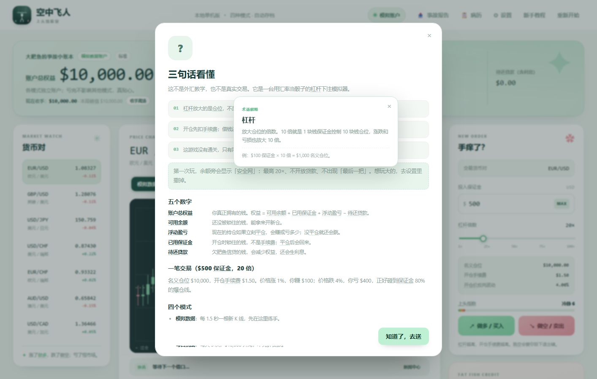

## 安全网 / 标准

第一次进入建议点「先学怎么输」，会自动进入**安全网**：

| | 安全网 | 标准 |
|---|---|---|
| 杠杆上限 | 20× | 100× |
| 肥鱼信贷 | 不开放 | 开放 |
| 亏损平仓 | 不出现「最后一把」 | 出现「最后一把」 |
| 每日挑战 | 固定标准规则 | 固定标准规则 |

余额旁的小标签会显示当前档位；点设置里的「安全措施」可以切换，有持仓时不能切。第一次玩也可以点余额旁的「?」看三句话说明。

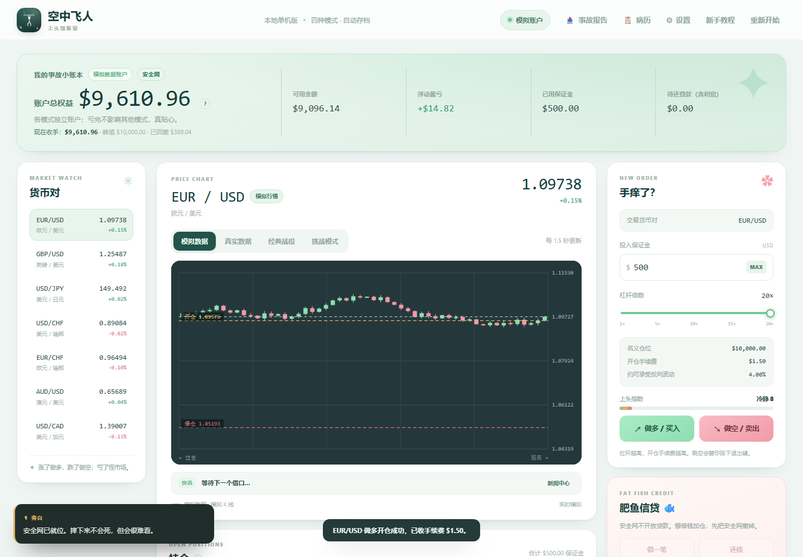

## 收手 / 穿仓结案

- 余额旁的「收手离场」会按当前价格结算所有持仓，结束本局，弹出结算：最终权益、本局峰值、最大回撤、待还贷款、“最后一次”次数、诊断。
- 结算后交易冻结，按钮变成「再来一局」；点它才真正清空当前模式重开。
- 结算弹窗里可以直接点「查看病历库」，不用再绕顶栏。
- 如果账户穿仓（现金为负或权益 ≤ 0），会自动弹出“账户已穿仓 · 本局结案”，同样可以「再来一局」。
- 每局结算会存进 localStorage 的 `af-cases-v1`，并出现在病历库里。
- 每日挑战「金盆洗手」也会留一份挑战结算记录。

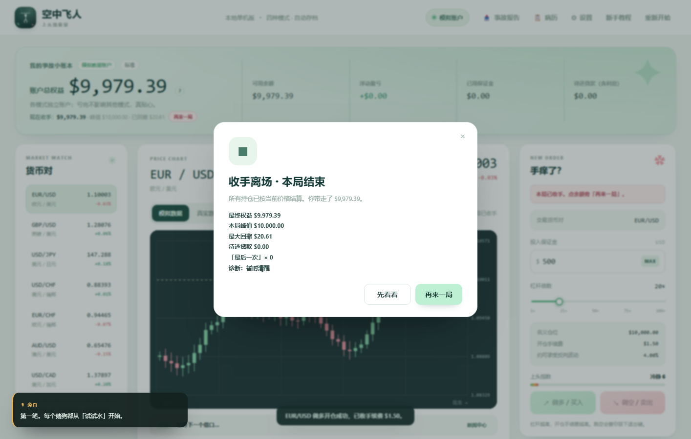

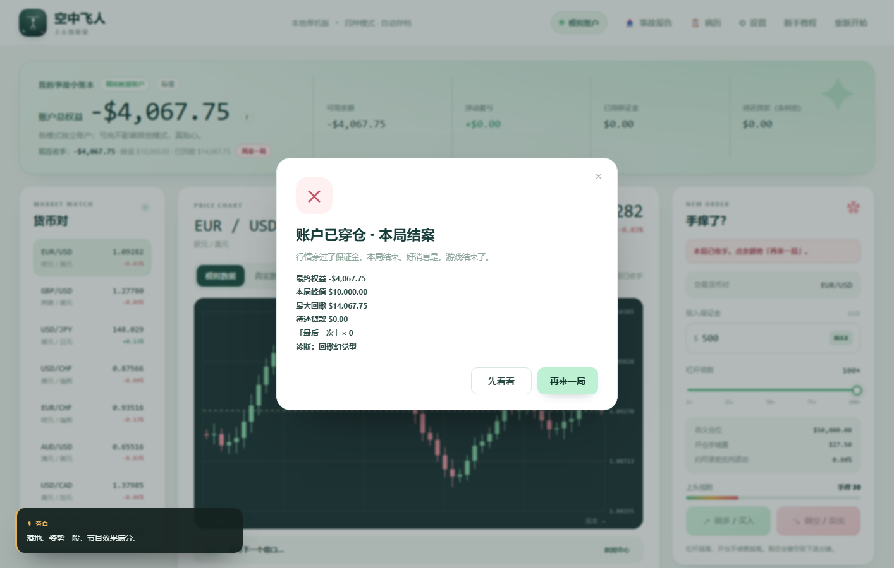

## 病历库

入口：顶栏「病历」→「病历库」。

- 列表显示日期、模式、结果（收手 / 穿仓 / 挑战结算）、权益、峰值、回撤、诊断；
- 点卡片展开详情：待还贷款、交易笔数、爆仓次数、「最后一次」次数；
- 可按模拟 / 真实 / 战役 / 挑战筛选；
- 「清空病历」会删除本机记录，有二次确认；
- 最多保留最近 30 份，旧的自动淘汰。

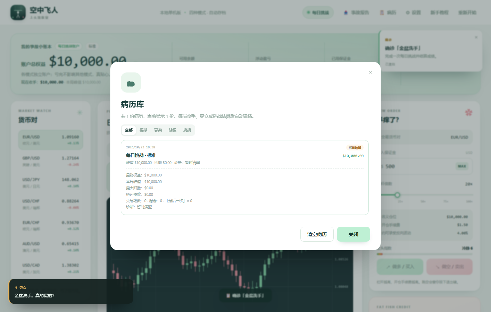

## 四种模式

| 模式 | 说明 |
|---|---|
| 模拟数据 | 每 1.5 秒一根新 K 线，随机游走叠加新闻冲击；贷款每 30 秒计一天利息 |
| 真实数据 | Frankfurter 历史日度汇率，30–600 天与今年区间，日/周/月 K，进度条与自动播放 |
| 经典战役 | 14 份事故档案，从事件前数周开始逐日回放，推送当时的市场快讯 |
| 每日挑战 | 每天 3 次，$10,000 开局，不开放贷款，最多 5 笔持仓；金盆洗手后进入本地病历榜 |

## 开局合同（模拟模式）

进入模拟模式后，先签一份合同，或者选自由模式。合同只在模拟模式生效。

| 合同 | 目标 | 限制 |
|---|---|---|
| 自由模式 | 没有目标 | 规则照旧 |
| 这个月房租 | 净赚 $800 | 最多 5 笔交易，不开放借款 |
| 还清肥鱼信贷 | 还清 $3,000，并让权益达到 $8,000 | 最多 10 笔交易，初始负债 $3,000 |
| 被裁员的第 30 天 | 净赚 $3,000 | 初始现金 $6,000，最多 8 笔交易，不开放借款 |

合同中途会触发事件，选择会影响现金、债务和利率。比如房东催租、朋友结婚随礼、HR 约谈、面试、父母来电。

账户卡上会显示合同、目标进度和已用交易次数。目标完成后可以收手，也可以继续贪；结算会记录合同完成情况和评级（S/A/B/C/D）。

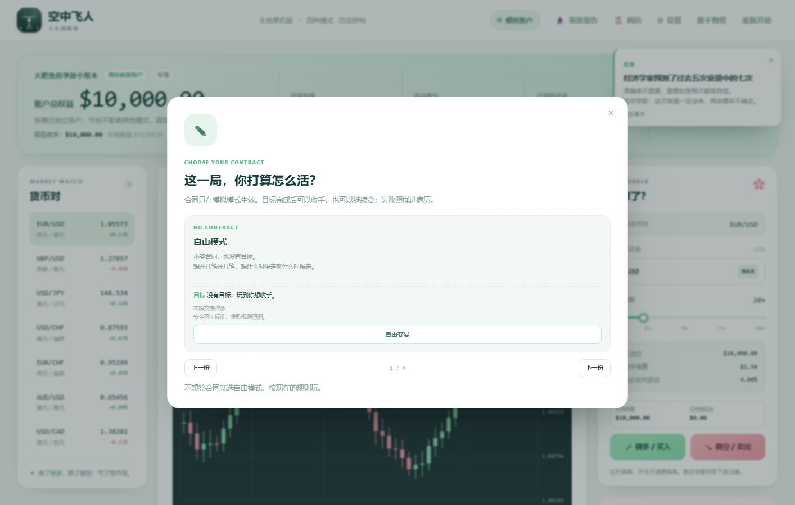

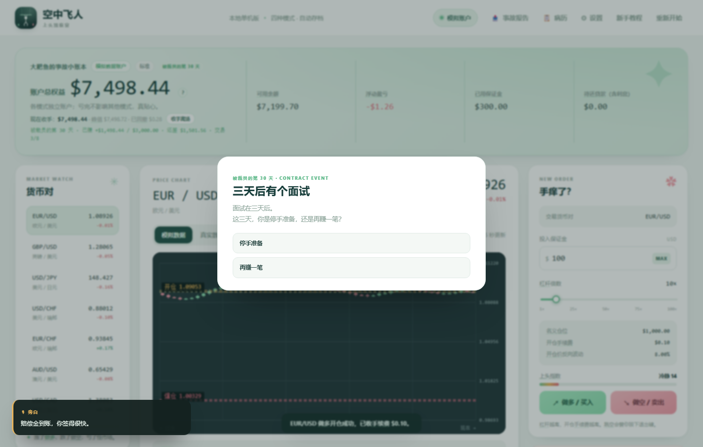

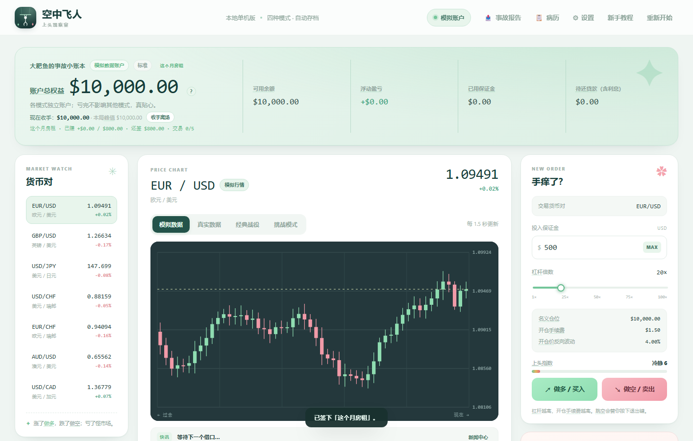

## 合同结局

每个合同有 3–4 个结局，由“是否完成目标 / 债务 / 关键事件选择”决定：

- **房租**：交上房租 / 下个月再说 / 账单替你记住 / 换个城市
- **还债**：上岸 / 家人兜底 / 轻装上阵 / 跑路
- **裁员**：重新入职 / 灵活就业 / 先干着 / 换个城市
- **通用**：自由落体（穿仓）；**空中飞人**（负债达到当前空中飞人线）

**空中飞人线**不是固定 $5,000：

```
$5,000 + 交易数 × $250 + 正收益 × 50%
```

四舍五入到 $100。玩得越久、赚得越多，要触发“空中飞人”所需的负债门槛越高。

事件选择会记录 flag，例如“告诉家人”“准备面试”“给房东转钱”，结局会读这些 flag。

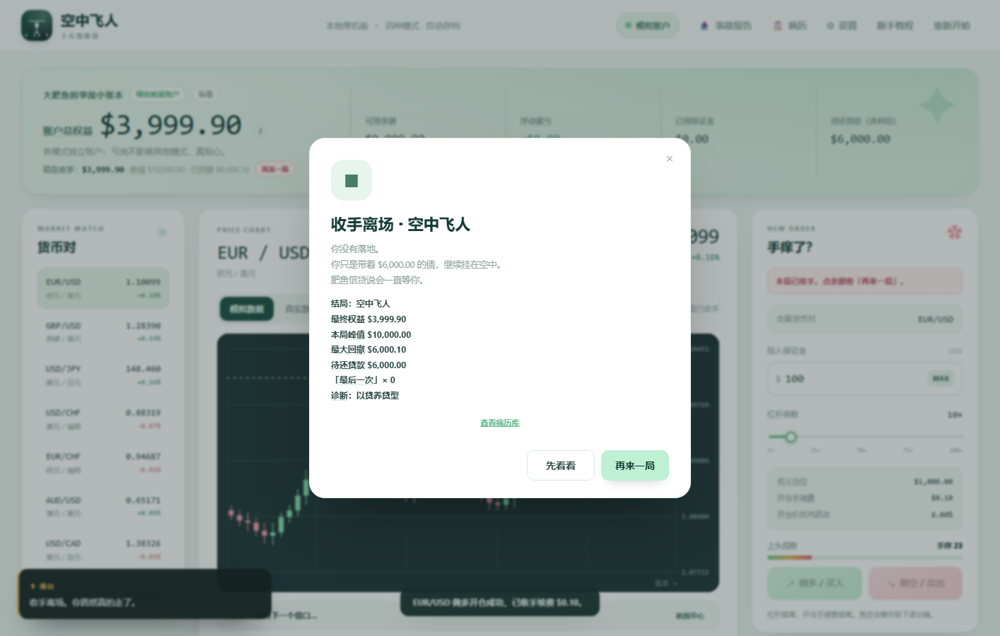

病历库会记录事件时间线，例如：

> HR 约谈 → 签协商离职（+$1,500）  
> 三天后有个面试 → 停手准备（-$100）

## 结局图鉴

入口：病历 → 病历库 → 结局图鉴。

- 目前 14 个结局；
- 已解锁的显示标题、结局文案和解锁日期；
- 未解锁的显示“？？？”和条件提示；
- 按通用 / 房租 / 还债 / 裁员分组；
- 旧病历里的结局会自动补录进图鉴。

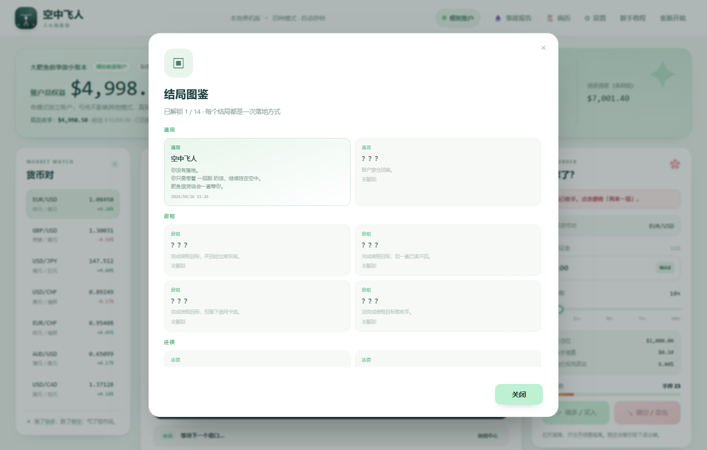

## 14 份事故档案

- 2000 欧元保卫战
- 2001 9·11 避险日
- 2008 雷曼时刻
- 2010 闪电崩盘
- 2011 欧债降级夜
- 2012 德拉吉时刻
- 2015 瑞郎脱钩之夜
- 2016 公投之夜
- 2020 疫情美元荒
- 2022 逼近平价
- 2022 日元干预时刻
- 2022 英债风暴
- 2023 硅谷银行 48 小时
- 2024 日元套息平仓

Frankfurter 的汇率数据始于 1999 年，所以 1997 亚洲金融危机没有收录；2000 年后的主要危机已覆盖。每份档案都有 S/A/B 事故等级、事件快讯和一句风凉话。

## 黑色喜剧层

- **旁白**：开仓、爆仓、借钱、拒绝补仓、收手都会触发毒舌旁白。
- **新闻条**：连续滚动，最多显示最近 5 条；没有新闻时显示 3 条新手提示，不再是一动不动的“等待下一个借口”。
- **实时事件**：最多 3 个事件同时生效，每个事件有 16–27 根 K 线的持续时间；事件卡只给标题、正文、梗和剩余根数，不标注受影响货币对和方向，需要玩家自己推断。
- **突发新闻**：9 根 K 线的短窗口、2.7–3.0× 波动，直接命中当前货币对，出现时用红色 `BREAKING` 标记。
- **相关与蝴蝶**：两国之间的贸易、制裁、疫情、航运事件会直接偏置相关货币；分析师、芯片、供应链等市场梗不直接给方向，只通过全市场波动产生蝴蝶效应。
- **整活新闻**：咖啡机、体检报告、外卖备注、房东、相亲、猫踩键盘、券商 PPT、塔罗牌非农等纯娱乐新闻，只进滚动条、新闻浮窗和新闻中心，不占用事件卡，也不改变行情。
- **段子事件**：50+ 条新闻模板，覆盖专家建议、财经大V、房东、交易所咖啡机、体检报告、外卖备注，以及海峡封锁、贸易战、疫情变种、港口拥堵、芯片缺货、制裁、停火传闻等国际局势事件；部分事件有后续链，比如“专家建议 → 专家关评论 → 专家删号”“新关税 → 反制清单 → 谈判重启”。
- **下单回执**：开仓后右侧立即出现当前持仓卡，显示方向、浮盈、开仓价和距爆仓百分比；可用余额和已用保证金会闪一下。
- **余额常驻**：下单区常驻显示可用余额和已用保证金，不用再往上看账户卡。
- **最后一次**：标准模式下，亏损平仓后主按钮是「最后一把，回本就走」，旁边是「算了，收手」。每按一次计数 +1，第 10 次确诊「最后一次」。安全网下不会出现这个按钮。
- **现在收手**：余额区显示当前可带走金额、本局峰值和回撤；旁边的「收手离场」会真正结算并结束本局。
- **风险线**：持仓后图表会画出开仓线、爆仓线，持仓行显示「现价距爆仓百分比」。
- **部分平仓**：持仓行可以平掉 25% / 50% / 75%，风险弹窗可以平掉一半；平仓后保证金和名义仓位按比例减少，剩余仓位继续跑。注意：平掉一半只锁定一半盈亏，剩余仓位的风险比例不会自动下降。
- **止损 / 止盈**：设置 →「进阶交易」打开后，下单时可填止损价和止盈价。只开仓时设置，开仓后不能改；触发按当前价成交，跳空可能更差；止损/止盈触发后不会出现「最后一把」。
- **肥鱼信贷**：随借随到，利息按天算，尊严按次算。图标直接用“大肥鱼”——原创鲸鱼娘，深海蓝发、鲸鱼尾发饰、鳍耳、制服和金币。
- **事故报告**：1080×1440 分享卡，带红色「建议休市」印章、诊断、峰值、回撤和“最后一次”次数。
- **病历本**：13 个成就全部改成确诊记录。

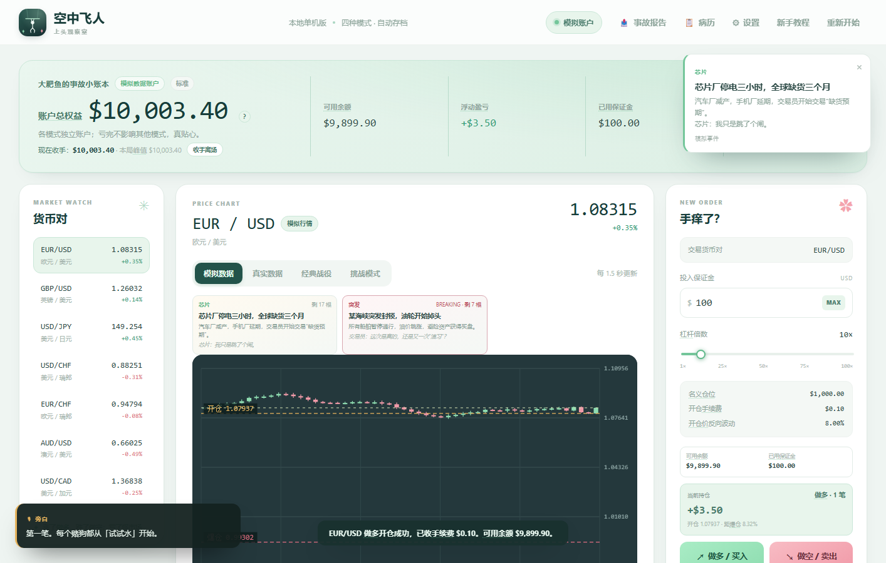


## 肥鱼信贷图标

原创形象在 `assets/dafeiyu.svg`：

- 大肥鱼是鲸鱼娘：深海蓝发、鲸鱼尾发饰、鳍耳、制服、金币；
- 贷款面板和“申请周转贷款”弹窗都用她；
- 不是 DeepSeek 官方鲸鱼或网上同人图，只借鉴“鲸鱼 + 深海蓝 + 打工人”的气质，形象是原创的。

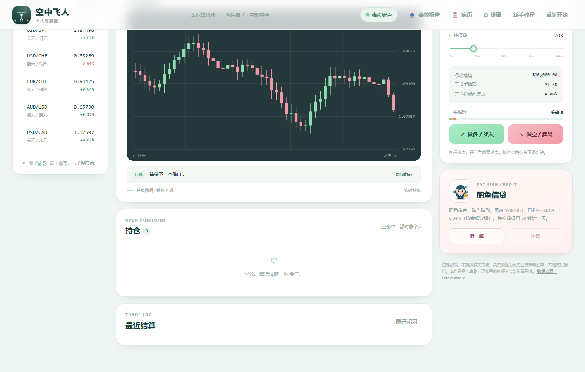

## 止损 / 止盈

设置 →「进阶交易」打开后，下单面板多出两个可选价格：

- **止损价**：价格到点自动认亏平仓；
- **止盈价**：价格到点自动落袋。

规则：

- 默认关闭，不影响新手界面；
- 只开仓时设置，开仓后不能改；
- 多单止损低于现价、止盈高于现价；空单反过来；
- 止损必须比爆仓价更早触发，否则会先爆仓；
- 触发按当前价成交，跳空时可能比设置价更差；
- 触发后不出现「最后一把」；
- 持仓行只在设置了的时候多一行小字：`止损 x · 止盈 y`。

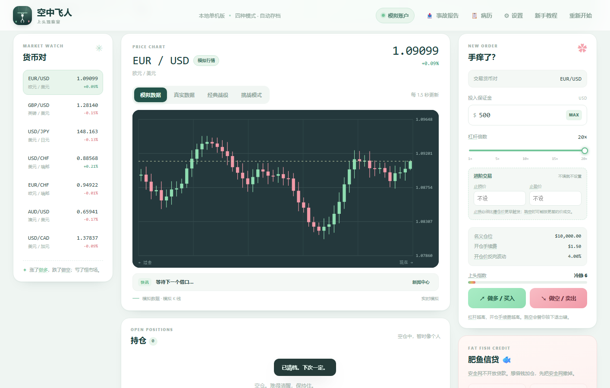

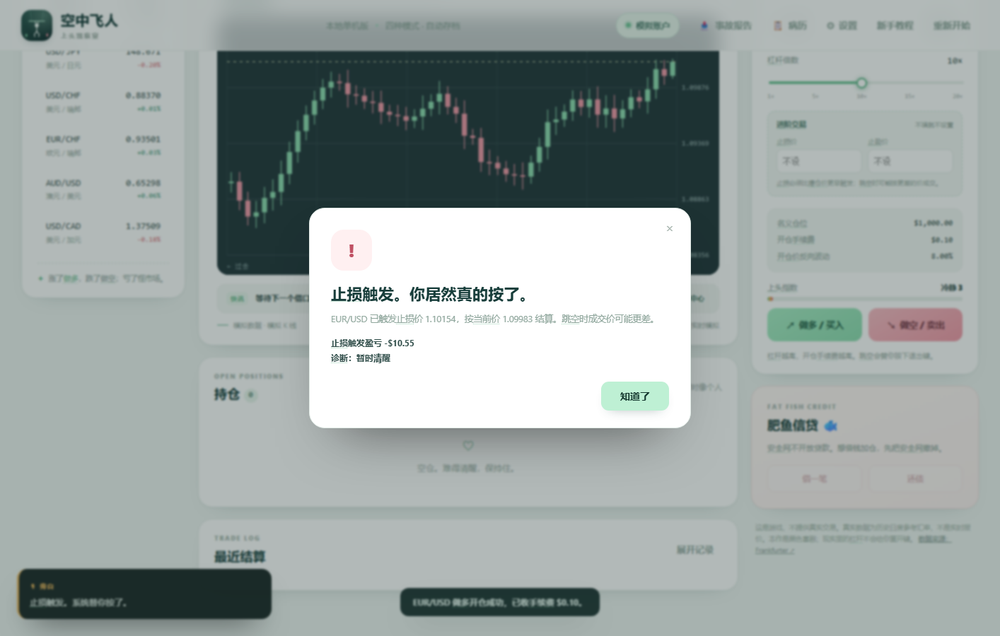

## 交易规则

- 7 个货币对；标准模式 1–100 倍杠杆，安全网最高 20 倍。
- 开仓手续费 = 名义仓位 × (0.00005 + 杠杆 × 0.000005)。
- 浮亏达到保证金 60% 触发风险提醒，80% 强制平仓；跳空可能穿仓。
- 部分平仓没有额外手续费，按比例释放保证金并结算对应盈亏。
- 止损/止盈触发没有额外手续费，按当前价结算；跳空可能滑点。
- 贷款上限 $200,000，日利率 0.01%–0.04%。
- 四种模式独立账户，进度保存在 localStorage。

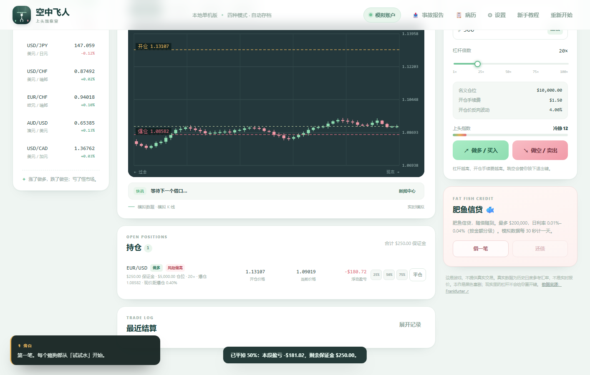

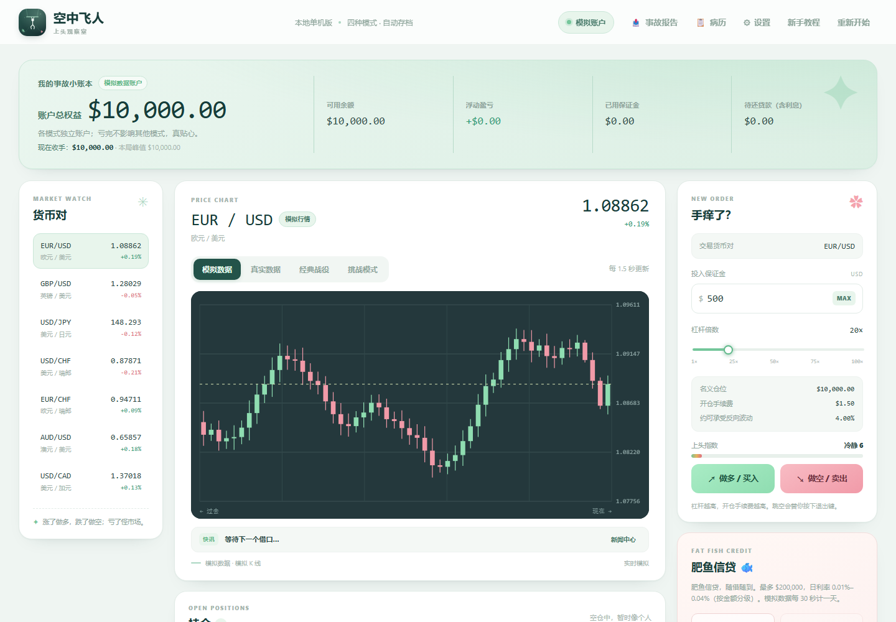

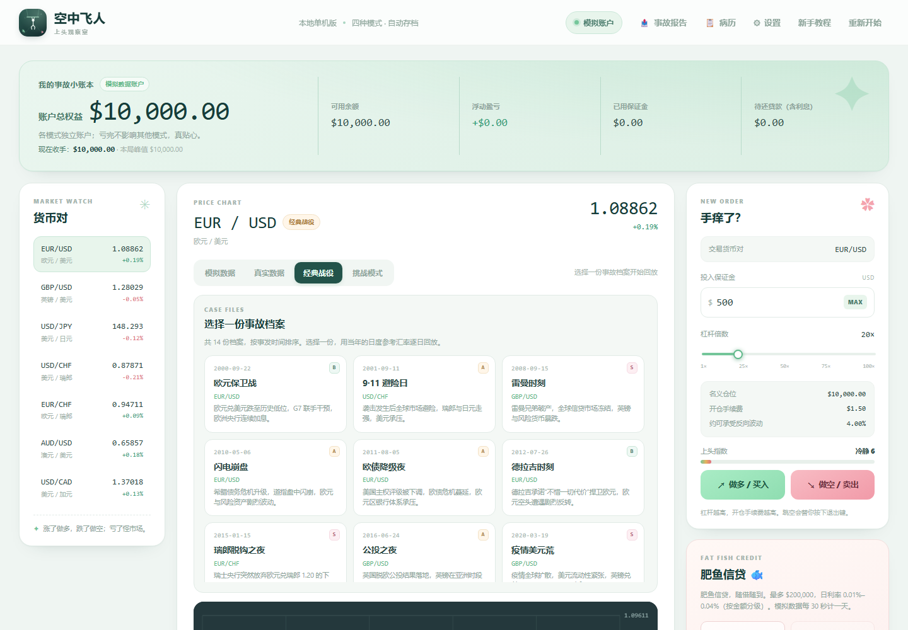

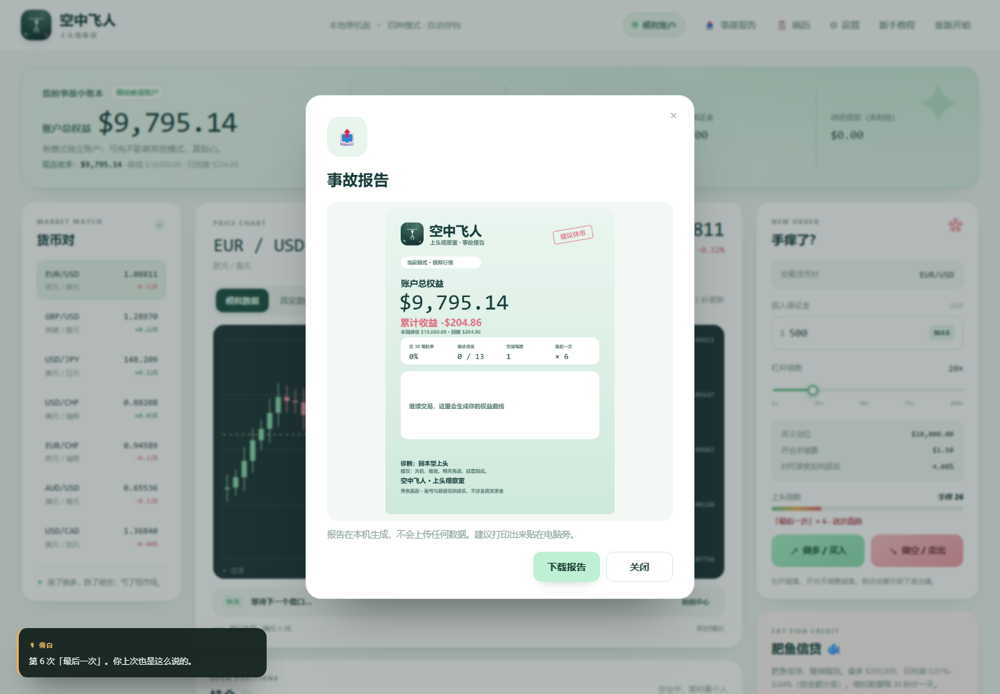

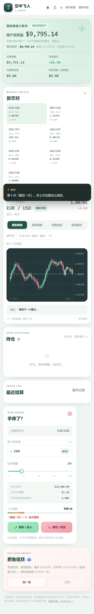

## 免责声明

真实数据来自 [Frankfurter](https://frankfurter.dev/)，是历史日度参考汇率，不是实时报价，也不构成任何投资建议。这是游戏，不提供真实交易；现实里的杠杆不会给你重开键。

## 文件结构

```
index.html    页面结构
styles.css    全部样式（昼夜主题 + 移动端）
data.js       货币对、14 份档案、快讯、教程、病历
chart.js      Canvas K 线
audio.js      WebAudio 音效与本地音乐
engine.js     行情、账户、交易、贷款、回放、挑战、存档
ui.js         渲染、弹窗、旁白、事故报告、设置
app.js        启动与 1.5 秒主循环
server.js     本地静态服务器
AirTrapeze.exe 带图标的启动器（转调 start.cmd）
assets/       图标（svg/png/ico）
```
